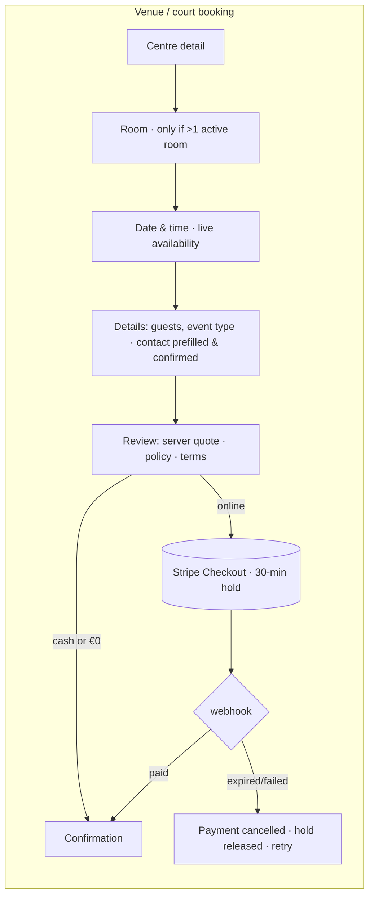
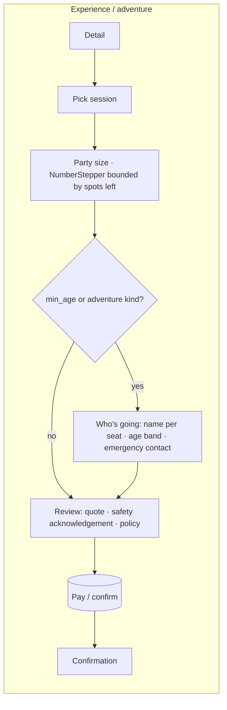
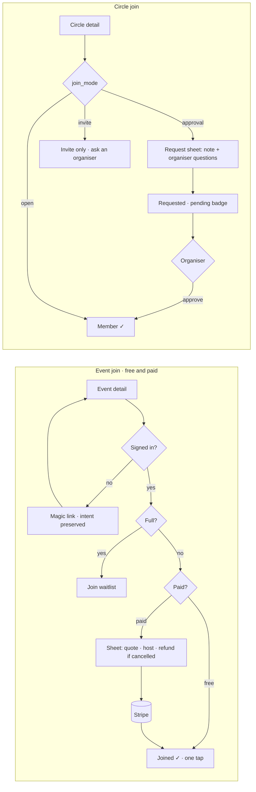
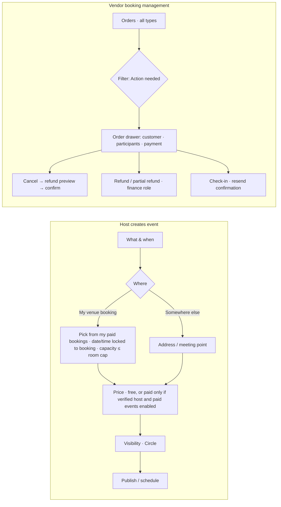

# HelloCircle — Booking & Joining UX: Implementation Plan

Planning document only. No code has been changed. Branch `feature/commerce-engine` @ `e2a74a6`, 2026-10-11.
Input: `docs/booking-checkout-audit-2026-10-11.md` (the "audit"), plus inspection of `client/src` and `server/src`.

---

## 0. Summary, decisions and hard dependencies

**Approach.** Don't build a new booking app. Build **one shared booking kit** (`client/src/components/booking/`) on top
of what already works:
- `components/form.tsx`: `Field`, `TextInput` (with labels, ids and errors), `NumberStepper`, `ChoiceCards`, `FormErrorSummary`
- `components/Stepper.tsx`
- `components/CheckoutBreakdown.tsx` (renders server quotes only)
- `components/SelfCancelControl.tsx` (server-authoritative cancel)
- `ui.tsx`: `Modal`, `Drawer`, `ConfirmDialog`, skeletons, `LoadErrorState`

Then move each flow onto the kit one at a time. The server-side engine stays untouched: capacity, holds, Stripe,
webhooks, refunds, coupons and RBAC.

### Decisions needed before Phase 1 (owner)

| # | Decision | Why it matters | Recommendation |
|---|---|---|---|
| D1 | **Brand palette vs. accessibility.** The brief's orange-red `#FF4B24` measures **3.04:1 on cream `#F7F4EC`** and **3.34:1 under white text**. Both fail WCAG AA (4.5:1) for body text and button labels. | Every primary CTA and link | Keep `#FF4B24` as the **fill** for primary buttons with **near-black `#172019` label text (5.0:1 ✓)**, and for large display accents. Add a text-safe shade **`#C7350F` (4.84:1 on cream ✓)** for orange text and links. |
| D2 | **Typography.** The brief says "Bricolage Grotesque typography". Today Bricolage is the *display* face and **Figtree is the body face** (deliberate, PR #11; see memory). | Body readability on long forms | Bricolage for headings, step titles and prices; keep Figtree for form body text. If the brief means Bricolage everywhere, I'll show a side-by-side preview first. |
| D3 | **Palette rollout scope.** Live tokens are `bg #fbfaf7`, `text #1e2420`, `orange #c74c1a`, `green #1e7a4c` (primary), radius 10/16 (`packages/design-tokens/src/index.ts:82-91`). A minimal-radius "swiss" set already exists (control 6 / card 2). | Switching tokens globally restyles the whole app and the mobile app (`packages/design-tokens/src/colors.ts`, hand-synced) | Scope the new palette to booking surfaces first, using a `data-surface="booking"` token scope. Make it global only after preview approval (per the "options before commit" feedback). |
| D4 | **Commercial model** (audit F1). Merchant vs agent, VAT per category. | It decides what the price summary says ("incl. VAT" vs "+ VAT + fee") | Blocks the all-in price display only. The UI renders whatever lines the server quote returns, so nothing else waits on this. |
| D5 | **Memberships** (audit scenario 9). | Whether a membership purchase screen exists | **Defer.** Not in this plan's build scope. |

### Hard rules (from the brief and the audit)

- **No client-side pricing as source of truth.** Every price shown comes from a server quote. `BookingFlow.tsx:163-166`
  currently computes VAT and fee client-side; that is removed.
- **Paid workflows the audit blocked stay off:**
  - **Open Booking resale** (audit P0, scenario 13): the "Open spots" UI is hidden unless `centre.openBookingEnabled`
    *and* the redesign has shipped. Ops sets the org feature flag off.
  - **Membership purchase:** not built (D5).
  - **Paid host events:** no new paid entry points until host payout is decided (audit P1, scenario 12). Existing paid
    joins keep working unchanged.
  - **Customer credits, rewards and engine pricing:** remain behind their existing `commerce.*` switches. The UI only
    reflects what the quote returns.
- **Audit P0 backend fixes come first** (Phase 0). The UX work must not ship on top of the trial bypass or the
  availability-predicate bug.

---

## 1. UX page inventory

Classification: **Keep** · **Improve** · **Consolidate** · **Build** · **Defer**. Priority: P0 (blocks launch) → P3.

### 1.1 Customer

| Route | Component | Existing functionality | UX problems | Reusable parts | Missing interactions | Backend dependencies | Required change | Class | Pri |
|---|---|---|---|---|---|---|---|---|---|
| `/centres/:id` | `pages/CentreDetail.tsx` (382) | Venue detail, rooms, CTA to `/book/:id` | Cancellation copy hard-coded ("48h"); no price-from incl. fees | `Card`, `AvailabilityBadge` | All-in "from" price; real org cancellation hours | Quote "from" price (D4); org `cancellationHours` in centre payload | Use `PolicySummary`; price from server | Improve | P2 |
| `/book/:centreId` | `pages/BookingFlow.tsx` (730) | 4 steps: room → date/time → details → review; coupon; cash/online; 409 recovery with similar venues | **Client-side VAT/fee math** (`:163-166`); labels not associated (`:472-492`); no `autocomplete`/`type="tel"`/`inputMode`; no prefill from resident; deposit promise copy (`:554`); no cancellation deadline on review; no hold timer | `Stepper`, availability fetchers, `MonthCalendar` patterns, 409 recovery | Server quote; prefill-and-confirm contact; policy summary; terms acknowledgement; hold countdown | **B1** booking quote; **B5** availability fix; **B6** Open Booking flag | Rebuild on `BookingShell` + kit; keep the room picker and calendar logic | **Improve** | **P1** |
| `/clubs/:id` | `pages/ClubDetail.tsx` (349) | Club detail, trial badge, register CTA | Trial CTA shown from `club.trial`, but the server doesn't enforce it (audit P0) | — | Age-eligibility hint | **B4** trial fix | Show eligibility (ages) up front | Improve | P2 |
| `/register/:clubId` | `pages/RegistrationFlow.tsx` (658) | Child/adult, guardian, emergency contact, medical, consent + waiver version, household picker, sessions, pass redemption, waitlist claim | 4 steps for one child; **mandatory home address** (`:135-136`); hand-rolled labels (17×`labelStyle`); no server quote; medical free text; no multi-child | **Household picker** (`:328`, preserve), pass redemption | Server quote; multi-participant; conditional emergency/medical; address optional | **B2** registration quote; **B4** | Move onto the kit; `ParticipantPicker` replaces the inline picker (same API) | **Improve** | **P1** |
| `/experiences/:id`, `/adventures/:id` | `pages/ExperienceDetail.tsx` (964) | Session list, party size, **server quote** + `CheckoutBreakdown`, credits (switch), email prefill (`:160,179`) | One name for the whole party; `min_age`/safety shown but not acknowledged; booking panel embedded in a 964-line page | `CheckoutBreakdown`, `quoteExperienceSession` | Per-seat names; safety acknowledgement; eligibility gate | **B7** per-seat participants; **B8** acknowledgement record; **B9** `min_age` enforcement | Extract the booking panel into `BookingShell`; keep the quote flow as is | Improve | P1 |
| `/programs/:id` | `pages/ProgramDetail.tsx` (637) | Enrol, `quoteProgram`, coupon | No household picker; hand-rolled form; no policy summary | `quoteProgram` | Participant from household; acknowledgement | B8 | Move the enrol panel onto the kit | Improve | P2 |
| `/games/:id` | `pages/GameDetail.tsx` + `components/GameJoinCard.tsx` (552) | Free/paid join, waitlist, `MobileJoinBar`, `quoteGame` | Join card does its own state machine; no refund/cancellation preview before paying; host identity not near the pay CTA | `GameJoinCard` state logic, `MobileJoinBar` | "What if it's cancelled" line; min-age gate | B9 | Wrap in `JoinPanel` (shared with Circles); keep the state logic | Improve | P2 |
| `/circles/:id` | `pages/CircleDetail.tsx` (1125) + `components/CircleJoinCard.tsx` (209) | Open/approval/invite join states, requested state | Request has no note or questions; "requested" state is easy to miss | `CircleJoinCard` `JoinState` enum | `RequestToJoinSheet` (note + organiser questions) | **B10** join-request note/questions | Add the sheet; reuse `JoinPanel` | Improve | P2 |
| `/payment/success` | `pages/PaymentSuccess.tsx` (279) | Polls status per ref prefix (6 types), add-to-calendar | No cancellation deadline, deposit date or "manage on another device" | `STATUS_FETCHERS` map | `ConfirmationPanel` sections | **B3** manage fields | Rebuild the body on `ConfirmationPanel`; keep polling | Improve | P1 |
| `/payment/cancel` | `pages/PaymentCancel.tsx` (31) | Static message | Doesn't say the hold is released or offer "try again" with the same details | — | Retry link back to the flow with state | — | `ConfirmationPanel` variant `cancelled` | Improve | P3 |
| `/bookings`, `/my-life` | `pages/MyBookings.tsx` (1187) | All participation types, lookup by ref + email, reschedule (venues), cancel, `SelfCancelControl` (experiences/programmes only) | **Two cancel patterns**: venue and registration cards hand-roll cancel and show no refund outcome; the venue cancel cutoff isn't shown | `SelfCancelControl`, `RescheduleForm` | One `ManageBookingCard` with deadline, refund outcome and reschedule | **B3** `canCancel`/`cancelDeadline`/`refundState` on bookings and registrations | Consolidate the six card variants into `ManageBookingCard` | **Consolidate** | P1 |
| `/make-it-happen` | `pages/MakeItHappen.tsx` (284) | Request → confirm creates a booking with open spots | Feeds the Open Booking resale path (audit P0) | — | — | B6 | No change; hide the resale step while B6 is off | Keep (gated) | P0 gate |
| — | Membership purchase | none | — | — | — | D5 | — | **Defer** | — |

### 1.2 Host (resident organiser)

| Route | Component | Existing | Problems | Dependencies | Change | Class | Pri |
|---|---|---|---|---|---|---|---|
| `/games/host`, `/games/host/:gameId` | `pages/HostGamePage.tsx` (710) | Stepper wizard, venue `<select>` (`:375`) or free-text location, price (verified hosts), lifecycle | **A venue can be picked without a reservation** (audit E2); 22 hand-rolled labels | **B11** link the event to a booking ref owned by the host | Venue step becomes a choice: "I've booked a venue (pick your booking)" / "Somewhere else (address)" | Improve | P1 |
| `/manage`, `/manage/circles/:id` | `ManageHome.tsx`, `ManageCircle.tsx` | Host hub, Circle management, join requests | Join requests show no note | B10 | Render the request note and answers | Improve | P3 |
| `/manage?tab=activities` → participants | `components/GameParticipants.tsx` (46) | Participant list, refund per participant | No bulk "cancel event and refund everyone" | Audit P1 (scenario 18) | Defer until the refund-on-cancel backend lands | Defer | P2 |

### 1.3 Vendor

| Route | Component | Existing | Problems | Dependencies | Change | Class | Pri |
|---|---|---|---|---|---|---|---|
| `/vendor?tab=bookings` | `components/VendorBookings.tsx` (939) | Bookings + registrations tables, status/when filters, detail modal, cancel, refund (finance), check-in, resend | Experiences and programmes live in other tabs; **cancel and refund are separate steps** (customer gets "cancelled" with no refund); no "refund required" queue; no deposit-due list | Audit P1 (vendor cancel → refund); **B12** refund-due list | One orders table across 4 types, with an "Action needed" filter (refund pending, deposit due) and `OrderDrawer` | **Consolidate** | P1 |
| `/vendor?tab=experiences` / `programs` | `VendorExperiences.tsx`, `VendorPrograms.tsx` | Per-listing bookings, cancel, refund, attendance | Duplicated booking tables | — | Reuse `OrderDrawer`; keep listing editors | Improve | P2 |
| `/vendor?tab=schedule` | Calendar | Room schedule | — | — | — | Keep | — |
| `/vendor` check-in | `VendorCheckInScreen.tsx` | QR/manual check-in | — | — | — | Keep | — |

---

## 2. User journeys

Notation: `[ ]` screen, `( )` server call, `{ }` decision. Steps appear only when their condition is true (progressive disclosure).





```mermaid
flowchart LR
  subgraph C[Club registration / programme enrolment]
    C1[Detail] --> C2{Signed in with household?}
    C2 -->|yes| C3[Pick member(s) · add new]
    C2 -->|no| C4[Participant: name, DOB if child]
    C3 --> C5{Child?}
    C4 --> C5
    C5 -->|yes| C6[Guardian = account holder, confirm · emergency contact · anything the coach should know]
    C5 -->|no| C7
    C6 --> C7[Review: quote · waiver/consent · trial only if club offers it]
    C7 --> PAY2[(Pay / confirm)] --> C8[Confirmation]
  end
```





**Progressive disclosure rules (all flows):**
- **Contact.** Name and email come from the resident when signed in. They show as one confirm line ("Booking as Aoife
  Byrne · aoife@…" with an "Edit" control), never as empty fields.
- **Phone.** Asked only if the listing or vendor requires it.
- **Emergency contact, DOB, medical note.** Only for child participants, adventure kinds or a listing with `min_age`.
- **Address.** Never by default. A per-listing optional question.
- **Coupon.** Collapsed "Have a code?" link.
- **Room step.** Skipped for single-room centres (already the case).

---

## 3. Design system and component architecture

### 3.1 Tokens (scoped to `[data-surface="booking"]` first; D3)

| Token | Value | Use |
|---|---|---|
| `--bk-bg` | `#F7F4EC` | page background |
| `--bk-ink` | `#172019` | text, borders-strong, dark buttons |
| `--bk-accent` | `#FF4B24` | primary button **fill** (label in `--bk-ink`), progress, selected state |
| `--bk-accent-text` | `#C7350F` | orange text and links (4.84:1 on cream) |
| `--bk-surface` | `#FFFFFF` | cards and sheets |
| `--bk-line` | `#172019` at 14% opacity | hairlines |
| radius | `radius.swiss` (control 6, card 2) | already in `packages/design-tokens/src/index.ts:86-90` |
| type | Bricolage (display: step titles, prices, confirmation headline); Figtree (body, D2) | `fonts.display` / `fonts.body` |
| focus | 2px `--bk-ink` outline + 2px offset | every control |
| touch | min 44×44px; inputs 16px font (stops iOS zoom) | mobile |

A dark-mode mapping is required, because `ThemeContext` exists. Define it alongside the scope rather than shipping
light-only.

### 3.2 Shared booking kit — `client/src/components/booking/`

| Component | Responsibility | Built from | Replaces |
|---|---|---|---|
| `BookingShell` | Layout: steps column + sticky summary rail (≥ 900px) / sticky bottom bar with total + CTA (mobile). Owns step state, back/next, `FormErrorSummary`, unsaved-draft restore. | `Stepper`, `form.tsx` | Per-page layout in BookingFlow/RegistrationFlow/ExperienceDetail panel |
| `ListingSummary` | Thumbnail, title, when/where, party. The same block in the rail, review and confirmation. | `Card` | Ad-hoc summaries |
| `SlotPicker` | Date grid + time slots from the availability API; disabled and closed states; keyboard navigable | existing BookingFlow calendar logic, extracted | BookingFlow inline calendar |
| `SessionPicker` | List of sessions with spots left (`AvailabilityBadge`) | `ui.tsx` | ExperienceDetail/RegistrationFlow inline lists |
| `ContactConfirm` | Prefilled identity line + edit; guest mode shows `TextInput`s with `autoComplete` name/email/tel, `type="email"`/`"tel"`, `inputMode` | `TextInput` | Hand-rolled contact fields |
| `ParticipantPicker` | Household members (multi-select when the flow allows), "add someone", per-seat name; DOB only when required | household API (existing), `ChoiceCards` | RegistrationFlow picker (`:328`); experience single-name field |
| `EligibilityNotice` | Age/fitness/requirements up front; blocks continue with a reason when ineligible | — | Display-only text today |
| `QuoteSummary` | Fetches and renders the **server quote**. Re-quotes on party/coupon/credit change (debounced). Shows quote loading, stale and error states. Never computes. | `CheckoutBreakdown` | BookingFlow `:163-166` client math |
| `CouponField` | Collapsed field; validates through the quote (not a separate preview) | existing `validateCoupon` until the quote supports it | 3 copies |
| `PolicySummary` | "Free cancellation until {date, Irish time}", deposit return date, refund rules. Values from the server. | — | Hard-coded "48h" copy |
| `Acknowledgement` | Required checkbox(es) with version id; terms, waiver, safety | `CheckboxGroup` | RegistrationFlow consent block |
| `HoldTimer` | Shows "We'll hold this until hh:mm" after a pending checkout starts (30 min). Display only; it never extends anything. | — | none |
| `SubmitBar` | Primary CTA with busy state, idempotent submit (disabled after the first click), total echo | `Button` | Per-flow buttons |
| `ConfirmationPanel` | success / pending (polling) / cancelled / failed variants: ref, summary, add to calendar, policy, manage link, next steps | `NextStepsPanel` | PaymentSuccess/PaymentCancel bodies |
| `ManageBookingCard` | One card for all six types: status, deadline, cancel (`ConfirmDialog` with refund outcome), reschedule (venues), refund badge | `SelfCancelControl`, `RescheduleForm` | 6 card variants in MyBookings |
| `JoinPanel` | Event and Circle CTA wrapper: state badge, primary action, sticky mobile bar | `GameJoinCard`/`CircleJoinCard` logic (kept) | Duplicated sticky-bar code |
| `RequestToJoinSheet` | Note + organiser questions for approval Circles | `Drawer` | none |
| `OrderDrawer` (vendor) | Customer, participants (medical shown only to permitted roles), payment lines, cancel → refund preview, refund, check-in, resend | `Drawer`, existing vendor API wrappers | `BookingDetailModal` + per-tab modals |

A **`useBookingDraft(key)`** hook keeps a guest's draft in `sessionStorage`, wrapped in try/catch. The onboarding
audit's draft persistence pattern already exists; reuse it.

**State model per flow** (in `BookingShell`):

```
idle → editing(step n) → quoting → ready → submitting
                                      ↘ quote_error (retry)
submitting → confirmed (free/cash) | redirecting (Stripe) | conflict (409: slot gone → alternatives) | rejected (400: field errors)
```

---

## 4. Backend dependencies

Most are small, additive and **non-UI**. The P0 rows are the audit's Phase 1 items: **prerequisites, not part of the UX build**.

| # | Change | Type | Needed by | Risk | Audit ref |
|---|---|---|---|---|---|
| B4 | Reject `trial` unless `clubs.trial=1`; one trial per resident/email per club | Fix | Registration | Low; audit existing rows | P0 4c |
| B6 | Open Booking resale off (org flag) until redesigned | Config | Venue booking (hide "Open spots") | None | P0 13 |
| B5 | `/availability` uses `occupiesCapacitySql()` | Fix | SlotPicker | Low | P1 E3 |
| B1 | `POST /api/bookings/quote` (room, date, time, duration, guests, coupon) → same breakdown shape as `PriceQuote`, from `createBookingInternal`'s pricing branch, factored out | New, read-only | QuoteSummary on venues | Low; must share code with checkout so they can't drift | F1/D-5 |
| B2 | `POST /api/registrations/quote` (club, session, trial, coupon, pass) | New, read-only | QuoteSummary on clubs | Low | — |
| B3 | Add `canCancel`, `cancelDeadline` (ISO), `canReschedule`, `refundState` to the booking and registration `/mine` and lookup payloads (experiences and programmes already have them via `selfCancel.ts`) | Additive fields | ManageBookingCard, ConfirmationPanel | Low; extend `selfCancel.ts` with `bookingCancelBlock` / `registrationCancelBlock` | P1 17 |
| B8 | `order_acknowledgements` (source_type, source_ref, kind, version, accepted_at): written in the same transaction as the order insert | New table (additive) | Acknowledgement | Low | C (terms) |
| B9 | Enforce `min_age` on experience and game join; collect age band or DOB only where `min_age` is set | Fix + field | EligibilityNotice | Medium; residents have no DOB today, so use a self-declared age band per participant | P1 3a |
| B7 | `experience_booking_participants` (booking_ref, seat, name, age_band) | New table (additive) | ParticipantPicker on experiences | Low | P2 16 |
| B10 | `circle_invites.note` + `circles.join_questions` (JSON) + conditional respond update | Additive | RequestToJoinSheet | Low | P2 8 |
| B11 | Game create/update accepts `bookingRef`: must be the host's own paid, non-cancelled booking; date, time and centre come from it; capacity ≤ room cap − guests. `centreId` without `bookingRef` → treated as a free-text location label. | Fix | HostGamePage venue step | Medium; grandfather existing rows | P1 E2 |
| B12 | `GET /api/vendor/orders?attention=1`: union of the 4 vendor order types with `refund_pending` / `deposit_due` flags | New, read-only | Vendor orders | Medium (query across 4 tables; respects `req.vendorIds` + roles) | P1 1e/18 |
| B13 | Vendor cancel → automatic full refund (reuses `refundPaidOnce`) | Behaviour change | OrderDrawer cancel copy | Medium; payment-adjacent, needs the Stripe TEST pass | P1 18 |
| B14 | Programme and registration responses expose `requiresPhone`, `requiresEmergencyContact`, custom optional questions | Additive | Progressive disclosure | Low | C |

---

## 5. Screen-by-screen specifications

Each spec covers route, component, role, fields, behaviour, states, API, acceptance criteria (AC) and tests (T).
Shared states, unless a spec overrides them:
- **loading:** skeletons (`ListingDetailSkeleton`)
- **load error:** `LoadErrorState` with retry
- **submit error:** `FormErrorSummary` focused at the top, plus inline field errors
- **409:** conflict panel with alternatives

### S1 — Venue booking · `/book/:centreId` · `BookingFlow` → `BookingShell` · guest or resident

- **Fields:**
  - room (when there's more than one room)
  - date, start, duration (whole hours, from `TIME_SLOTS`)
  - guests (`NumberStepper`, 1…room cap)
  - event type (chips)
  - contact (`ContactConfirm`)
  - notes (optional, collapsed "Anything the venue should know?")
  - coupon (collapsed)
  - terms acknowledgement
- **Behaviour:**
  - Slots load per day. A taken slot is disabled with a reason.
  - Changing room, date, duration or guests re-quotes (debounced 300ms).
  - "Open spots" stays hidden while B6 is off.
- **States:**
  - quote loading: summary shimmer, CTA disabled
  - quote error: "Couldn't price this — retry", CTA disabled
  - 409 slot taken: return to the date/time step with the slot marked and similar venues (existing)
  - online: redirect to Stripe and show `HoldTimer` copy before redirecting
  - cash: confirmation with "Pay €X at the venue"
- **API:** `fetchCentre`, `fetchAvailability(Range)`, **B1 quote**, `createBookingCheckout` (unchanged payload).
- **AC:**
  1. No price arithmetic in the component (grep guard in test).
  2. The displayed total equals the quote, and the quote equals the Stripe line-item sum for the same inputs.
  3. Every input has an associated label (axe clean).
  4. Signed-in residents never see empty name/email fields.
  5. Single-room centres start at date/time.
  6. The review shows the cancellation deadline as a date in Irish time.
  7. Works at 360px with no horizontal scroll; the sticky total bar never covers the focused field.
- **T:** quote equals checkout total (API); slot taken → 409 UI; cash vs online paths; keyboard-only completion; prefill; the B5 availability case.

### S2 — Club registration · `/register/:clubId` · `RegistrationFlow` → `BookingShell` · guest or resident

- **Fields:**
  - participant(s) via `ParticipantPicker` (household multi-select)
  - DOB (child)
  - team/age group
  - guardian = account holder (confirm line)
  - emergency contact (child only)
  - "Anything the coach should know?" (optional, replaces "medical", with a purpose note)
  - session (when the club has sessions)
  - trial toggle **only if `club.trial`**
  - pass (when the resident has credits)
  - coupon
  - waiver acknowledgement (versioned)
- **Removed:** mandatory home address (B14 lets a club ask for it optionally).
- **Behaviour:**
  - Multi-select creates one registration per participant in sequence.
  - The **server call stays per participant** (no new batch endpoint in this phase).
  - A partial failure shows which participant failed and keeps the others confirmed.
  - The quote shows the per-participant total × n, coming from n quotes.
- **States:** duplicate (409 duplicate → "Already registered" on that participant chip); club full → waitlist CTA (existing).
- **API:** household list, **B2 quote**, `createRegistrationCheckout` (unchanged), pass redemption (unchanged).
- **AC:**
  1. The household picker keeps working (regression).
  2. The trial toggle is absent when `club.trial=0`.
  3. Address is not required.
  4. An adult flow never asks for DOB, guardian or emergency contact.
  5. The waiver version is sent.
- **T:** sibling × 2 happy path; one sibling duplicate; trial hidden or present; pass redemption unchanged; the B4 server test.

### S3 — Experience booking · `/experiences/:id` booking panel → `BookingShell` (inline variant) · guest or resident

- **Fields:**
  - session
  - party size (`NumberStepper`, max = spots left)
  - who's going: names per seat (B7), plus age band if `min_age` is set (B9)
  - emergency contact (adventure kind)
  - contact
  - coupon
  - credits toggle (only when the quote returns credit)
  - safety + terms acknowledgement (B8)
- **States:** `EligibilityNotice` blocks continue when any seat is under `min_age`; session full → disabled with "Full"; quote expired (engine `quote_expired` 409) → silent re-quote, then ask to confirm the new total.
- **API:** `quoteExperienceSession` (existing), checkout (existing + participants + acknowledgement).
- **AC:**
  1. `CheckoutBreakdown` remains the only price renderer.
  2. Seats ≥ 2 require a name per seat.
  3. The safety acknowledgement is stored with the version.
- **T:** party of 3 with names; under-age blocked client- and server-side; engine on/off both render.

### S4 — Programme enrolment · `/programs/:id` → `BookingShell` (inline)

- **Fields:** participant (household), contact, coupon, acknowledgement. Quote via `quoteProgram` (existing).
- **AC:** the household picker is available; the policy shows "cancel any time before the first session" (or the server value).
- **T:** enrol free and paid; self-cancel from My Life still works.

### S5 — Event join · `/games/:id` · `GameJoinCard` inside `JoinPanel` · resident

- **Free:** one tap → joined. No form.
- **Paid:** sheet with quote (`quoteGame`), host card, "If the host cancels you'll be refunded" (shown only once B13-equivalent host refund exists; otherwise "Contact the host"), coupon, pay.
- **States:** full → waitlist; waitlist offer → claim with countdown (existing); pending payment → "Finishing your payment…" with a resume link.
- **AC:** no new paid entry points; existing paid join is unchanged; `MobileJoinBar` uses `JoinPanel`.
- **T:** free join, paid join (stub provider), full → waitlist, offer claim.

### S6 — Circle join · `/circles/:id` · `CircleJoinCard` inside `JoinPanel` + `RequestToJoinSheet` · resident

- **Open:** one tap.
- **Approval:** sheet with an optional note (500 chars) plus up to 3 organiser questions (B10).
- **Invite:** explanatory state, no CTA.
- **States:** requested (persistent badge + "Withdraw request"); approved → notification → member; declined → "Request again" after a decline.
- **AC:** a double submit makes one request (server idempotent, existing HC-QA-033); organisers see the note in Manage.
- **T:** each join mode; idempotent request; respond race (B10 conditional update).

### S7 — Payment result · `/payment/success`, `/payment/cancel` · `ConfirmationPanel`

- **Success** shows:
  - ref
  - `ListingSummary`
  - total paid
  - cancellation deadline
  - deposit return date (venues; copy follows audit 1e: "returned after your event by the venue" until automation exists)
  - add to calendar
  - "Manage booking" (works on another device through ref + email lookup)
  - next steps
- **Pending:** polls every 2s for up to 60s (existing). After that: "Payment received; confirmation is taking longer. We'll email you."
- **Cancel:** "No charge was made. Your place was released." Offer "Try again" back to the flow with the draft restored.
- **AC:** never claims "paid" before the status endpoint says so.
- **T:** each of the 6 ref prefixes; slow webhook; cancel → draft restored.

### S8 — My Life / bookings · `/bookings` · `ManageBookingCard` × type · guest or resident

- **One card** for: venue booking, registration, programme, experience, event, pass.
- **Card actions come from the server** (B3): cancel (only if `canCancel`), reschedule (venues, `canReschedule`), refund badge (`refundState`).
- The cancel dialog states the outcome before confirming:
  - "You'll be refunded €X" (once auto-refund ships)
  - "Refund will be issued by the venue" (Policy A, until then)
  - "No refund: inside the {n}-hour window"
- **AC:** no client-side cutoff math; the copy matches `refundState`.
- **T:** within and outside cutoff per type; already cancelled (409); lookup-recovered booking cancel.

### S9 — Host event creation · `/games/host` · `HostGamePage` steps rebuilt with `form.tsx`

- **Where step:** "My venue booking" (list of the host's own paid upcoming bookings; picking one locks the date, time and venue, and caps capacity) / "Somewhere else" (address + meeting point).
- **Price step:** visible only to verified hosts (existing gate). Default free.
- **AC:** a centre can't be chosen without a booking (B11); existing events remain editable.
- **T:** create with booking; create with address; attempt with someone else's booking ref → 403.

### S10 — Vendor orders · `/vendor?tab=bookings` · `VendorBookings` → orders list + `OrderDrawer` · vendor (RBAC)

- **Columns:** when, listing, customer, party, total, status, payment, attention.
- **Filters:** all / upcoming / action needed / cancelled; type.
- **Drawer actions** (each role-gated as today: `centre_manager`, `facility_manager`, `finance`):
  - cancel (with refund preview, B13)
  - refund (full or partial; finance)
  - check-in
  - resend
- **Data minimisation:** medical/coach notes shown only to roles that manage that listing type; the view is access-logged (audit E9 follow-up).
- **AC:**
  1. Read-only analyst sees no action buttons.
  2. The refund button is disabled with the reason for cash orders.
  3. The 409 "already refunded" path shows the current state.
- **T:** role matrix per action; refund idempotency (double click); partial then rest refund.

---

## 6. Implementation phases

Each phase is an independently shippable PR. Nothing is pushed or deployed without an explicit instruction.

| Phase | Scope | Depends on | Exit criteria |
|---|---|---|---|
| **0 — Prerequisites** (audit Phase 1 subset, backend) | B4 trial fix, B5 availability, B6 Open Booking flag off, B1 + B2 quote endpoints, B3 manage fields | Approval | Server tests for each; `qa:booking` green (TEST mode) |
| **1 — Design tokens + kit foundation** | Scoped `[data-surface="booking"]` tokens (D1–D3); `BookingShell`, `ListingSummary`, `ContactConfirm`, `QuoteSummary`, `PolicySummary`, `SubmitBar`, `Acknowledgement`, `ConfirmationPanel`, `useBookingDraft` | D1–D3 preview approved | Component tests; an internal kit page showing every state in light and dark |
| **2 — Venue booking + club registration** | S1, S2 on the kit; remove client pricing; `ParticipantPicker` with household (multi) | 0, 1 | AC S1/S2; axe clean; existing booking/registration e2e green |
| **3 — Post-booking** | S7, S8 (`ManageBookingCard` across 6 types) | 0 (B3), 1 | Every type cancels from one card; copy matches `refundState` |
| **4 — Experiences, programmes, events** | S3, S4, S5; B7, B8, B9 | 1, 2 | Per-seat names; safety acknowledgement stored; `min_age` enforced |
| **5 — Circles + host** | S6 (B10), S9 (B11) | 1 | Venue-linked events only through a booking |
| **6 — Vendor orders** | S10, B12; B13 behind its own release once Stripe TEST passes | 1; B13 is payment-adjacent | Role matrix green; refund flows TEST-verified |
| **7 — Regression + launch QA** | §7 matrix in full; mobile device pass; a11y pass | all | All P0/P1 tests green; no audit P0 open |

**Out of scope here:** membership purchase (D5), Open Booking resale redesign (audit Phase 2/4), Connect/settlement,
sub-hour slots, the mobile app (`apps/mobile`). The mobile app shares tokens through `packages/design-tokens`, so D3
must state whether mobile follows.

---

## 7. QA test matrix

Layers:
- **U** Vitest unit (client)
- **S** server Vitest (isolated Docker)
- **I** `qa:*` integration/Playwright (isolated DB, Stripe TEST or stub)
- **A** axe/a11y spec
- **M** mobile viewport (375×812, iOS keyboard)

| ID | Area | Case | Expected | Layer | Pri |
|---|---|---|---|---|---|
| Q1 | Pricing | Venue quote equals checkout total equals Stripe line sum | equal to the cent | S, I | P0 |
| Q2 | Pricing | No arithmetic on `VAT_RATE`/`PLATFORM_FEE_RATE` in client booking components | static guard passes | U | P0 |
| Q3 | Trial | `trial:true` on a club with `trial=0` | 400; UI hides the toggle | S, I | P0 |
| Q4 | Open Booking | Flag off | "Open spots" absent; API 403 | S, I | P0 |
| Q5 | Availability | Cancelled booking's slot | shown as free | S, I | P1 |
| Q6 | Holds | Online checkout abandoned | slot free after 30 min; cancel page says released | I | P1 |
| Q7 | Concurrency | Two users submit the same slot | one confirmed, one 409 with alternatives | S, I | P1 |
| Q8 | Prefill | Signed-in resident on every flow | no empty name/email fields | I | P1 |
| Q9 | Household | Register 2 siblings | 2 registrations; one duplicate handled | I | P1 |
| Q10 | Eligibility | Under `min_age` seat | blocked client-side and 400 server-side | S, I | P1 |
| Q11 | Acknowledgement | Paid order without acknowledgement | 400; stored version on success | S | P1 |
| Q12 | Manage | Cancel inside and outside the cutoff, per type | button visibility and copy match `refundState` | I | P1 |
| Q13 | Confirmation | Each ref prefix polls the right status endpoint | correct summary | U, I | P1 |
| Q14 | Circle | Approval request with note; double submit | one request; organiser sees the note | S, I | P2 |
| Q15 | Host | Event with a venue but no booking ref | rejected; with own booking accepted | S, I | P1 |
| Q16 | Vendor RBAC | analyst/finance/manager per action | matches the authorization matrix | I | P1 |
| Q17 | Refund | Double-click refund | one provider refund; second 409 | S, I | P1 |
| Q18 | A11y | axe on S1–S10 every step | 0 serious/critical; labels associated; focus visible | A | P1 |
| Q19 | Keyboard | Complete S1, S2 without a mouse | possible; focus order logical; errors announced | A | P1 |
| Q20 | Mobile | 360/375 widths, keyboard open | no horizontal scroll; sticky bar doesn't cover fields; `inputMode`/`autocomplete` correct | M | P1 |
| Q21 | Contrast | Tokens | text ≥ 4.5:1, large/UI ≥ 3:1 in both themes | U (token test) | P1 |
| Q22 | Draft | Leave and return mid-flow (guest) | draft restored; private mode doesn't crash | U, I | P2 |
| Q23 | Dark mode | All kit components | readable, correct tokens | A | P2 |
| Q24 | Regression | Existing `qa:booking`, `qa:stripe`, `qa:lifecycle` suites | unchanged green | I | P0 |

**Preserved-functionality checks** (run before and after every phase): capacity/hold invariants, webhook idempotency,
`refundPaidOnce`, coupon reserve/release, household picker, pass redemption, RBAC. This is the existing server suite
(774 tests) plus `qa:booking` and `qa:stripe` in TEST mode.

---

## 8. Approval checklist

1. D1–D3: palette, typography and scope. I'll produce an uncommitted visual preview of the kit (S1 review step, mobile
   and desktop, light and dark) for sign-off before any token change.
2. Confirm D5 (memberships deferred) and that Open Booking resale stays off.
3. Approve Phase 0 (backend prerequisites) to start.

---

## 9. Implementation log (2026-10-11)

Built on `feature/commerce-engine`, **uncommitted**. Nothing pushed or deployed; no dev/prod data written.
Design decisions taken: D1–D3 = option A (orange-red fills with ink labels, `#C7350F` for orange text,
Bricolage headings + Figtree body, booking surfaces only); D5 memberships deferred; Open Booking resale off.

| Phase | Delivered | Deviations / notes |
|---|---|---|
| 0 | B4 trial only where offered + once per participant; B5 availability uses the checkout occupancy rule; B6 platform switch `commerce.open_booking` (default off) gates Open Booking + Make It Happen; B1 `POST /api/bookings/quote`, B2 `POST /api/registrations/quote` (shared pricing functions with checkout); B3 `canCancel`/`canReschedule`/`cancelDeadline`/`refundState` on booking + registration lists | Also: unapproved centres/clubs now refuse bookings; refunded rows now listed in My Life |
| 1 | `client/src/components/booking/` kit: scoped tokens generated from one palette (contrast-tested light + dark), shell/progress/submit bar, fields, quote/policy/listing summaries, confirmation panel, draft + quote hooks; dev-only `/dev/booking-kit` | Component tests via `react-dom/server` (no DOM library added) |
| 2 | Venue booking and club registration rebuilt on the kit; prices only from server quotes; no home address; coach note kept out of the stored draft | Multi-child checkout deferred (paid registrations each need their own Stripe session — needs a batch endpoint) |
| 3 | Payment success/cancel on the kit; `POST /api/checkout/:ref/abandon` releases the guest's own hold via the provider-expiry path (never a paid/completing session); status endpoints return `cancelDeadline`; My Life booking/registration cards follow server cancel/reschedule/refund state | My Life keeps the app's palette (D3 scope) |
| 4 | `order_acknowledgements` (terms version resolved server-side, safety-text fingerprint) and `experience_booking_participants`; min-age enforced (declaration) for experiences and activities; experience dialog, programme enrolment (household picker), activity join confirm updated | Acknowledgements are **recorded, not yet mandatory** server-side (~100 existing test/harness callers); 4 Playwright specs updated |
| 5 | Approval Circles: organiser questions, requester note + answers, race-safe respond; activities name a venue only via the host's own matching booking (`venueBookingProblem`), host picker lists own bookings; audit E1: guest can't cancel/move a booking an activity is held on, a venue cancel cascades to the activity and notifies participants | `stage-b-visibility-2` spec seeds a host booking |
| 6 | Provider cancellations (booking, registration, programme, experience, whole experience session) refund paid online orders in full via refund-once; `GET /api/vendor/orders` with `refund_pending` / `deposit_due`; "Action needed" panel with confirm-before-refund | Refund still finance-role-gated in the panel; cancellation stands if the refund fails (audited, flagged) |
| 7 | Hot-path indexes (audit E5); full client + server suites; QA booking integration suite | Stripe TEST harness (`qa:stripe`) not run — it calls Stripe's test API |

Still open (not in this plan's build scope): pricing/VAT model decision (audit F1), Open Booking resale redesign,
customer memberships, sub-hour court slots, making acknowledgements mandatory, multi-child registration,
the remaining audit items in `docs/booking-checkout-audit-2026-10-11.md` §H Phase 2–5.

**Verification (2026-10-11):** server Vitest 801 passed / 23 skipped (78 files, isolated Docker); client Vitest 172
passed; typecheck + production build pass; `qa:booking` 38 passed (2 partitioned skips), exit 0; `qa:lifecycle`
20 + 29 findings passed. **Not passing, pre-existing:** the three `HC-QA-001` bottom-chrome specs time out because
commit `3640b1a` (2026-10-10, Stage 5c) renamed the consent banner's "Accept" button to "Accept all" (and added
"Choose…"); the specs still look for "Accept". In a 390 px check the taller banner's bottom (810 px) also overlapped
the tab bar top (781 px) — likely a real layout regression from that commit, worth a look before updating the specs.
Not run: `qa:stripe` (Stripe TEST API), `qa:browsers`, `qa:security-gate`, `qa:authorization`.
